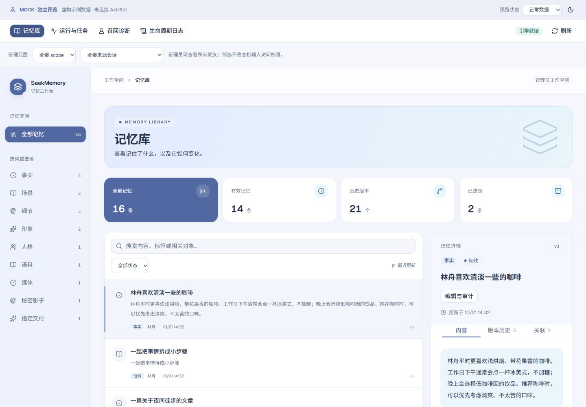

# SeekMemory WebUI 预览资源

本分支只存放预览图片，不合入插件代码分支，也不进入 Release 安装包。

所有数据、来源、账本、任务与错误均为虚构 Mock；日志示例行号不保证与后续代码相同。
Mock 诊断仅做简化文本匹配，不能用于证明真实召回质量。源码位置与业务阶段已另用真实 Python 测试验证。

## v0.3.1 适配预览

新增话题队列与策略、主体与时间、逐条披露结果。披露级别为 Mock 排版示例，不模拟真实规则。

| 页面 | 预览 |
|---|---|
| 话题与抽取策略、待提交强化 | [查看](images/topic-runtime.png) |
| 记忆主体、说话人、事件与有效期 | [查看](images/memory-attribution.png) |
| 全文、改述、提示、静默 | [查看](images/recall-disclosure.png) |

## 冷蓝主题

参考人物发色与浅蓝配饰，使用冷蓝主色、浅蓝辅助色与少量淡粉装饰。
实色选中项和首张统计卡、浅蓝标题区、白色内容卡片形成层次；警告、错误与正常状态保留独立语义色。
本组 11 张预览使用同一套生产组件，覆盖浅深主题、桌面与 390px 手机布局。

| 页面 | 浅色 | 深色 |
|---|---|---|
| 记忆库完整页面 | [查看](images/theme-memory-light.png) | [查看](images/theme-memory-dark.png) |
| 生命周期日志与异常展开 | [查看](images/theme-logs-light.png) | [查看](images/theme-logs-dark.png) |
| 手机记忆库 | [查看](images/theme-mobile-light.png) | [查看](images/theme-mobile-dark.png) |
| 编辑与审计 | — | [查看](images/theme-editor-dark.png) |
| 手机详情抽屉 | — | [查看](images/theme-mobile-detail-dark.png) |
| 运行与任务 | [查看](images/theme-runtime-light.png) | — |
| 召回诊断结果 | [查看](images/theme-diagnostics-light.png) | — |

## 旧主题功能参考（25 张）

以下保留早期截图，用于展示九种类型、版本关联、来源账本、任务确认与诊断空结果等功能。
颜色以当前主题预览为准；旧截图不代表最新调度数量与账本字段值。

| 功能 | 完整预览 |
|---|---|
| 记忆库总览 | [查看](images/webui-memory.png) |
| 事实 | [查看](images/category-fact.png) |
| 场景 | [查看](images/category-scene.png) |
| 细节 | [查看](images/category-detail.png) |
| 印象 | [查看](images/category-impression.png) |
| 人格 | [查看](images/category-persona.png) |
| 语料 | [查看](images/category-example.png) |
| 媒体 | [查看](images/category-media.png) |
| 秘密影子 | [查看](images/category-secret.png) |
| 指定交付 | [查看](images/category-designated.png) |
| 召回诊断：命中、指标和 scope | [查看](images/diagnostics-result.png) |
| 召回诊断：无命中 | [查看](images/diagnostics-empty.png) |
| 诊断结果局部 | [查看](images/diagnostics-scope.png) |
| 业务日志：源码位置、阶段、耗时和异常 | [查看](images/webui-logs.png) |
| 日志组合筛选 | [查看](images/logs-filtered.png) |
| 手机日志布局 | [查看](images/logs-mobile.png) |
| 版本比较 | [查看](images/memory-versions.png) |
| 关联记忆 | [查看](images/memory-relations.png) |
| 手动修订 | [查看](images/webui-editor.png) |
| 历史 blob 与快照 | [查看](images/editor-audit.png) |
| 来源证据与 lineage | [查看](images/editor-evidence.png) |
| 变更账本 | [查看](images/editor-ledger.png) |
| 运行检测与任务 | [查看](images/webui-runtime.png) |
| 维护操作确认 | [查看](images/task-confirmation.png) |
| 手机深色记忆库 | [查看](images/webui-mobile.png) |

## 印象

## 召回诊断：命中、指标和 scope

## 业务日志：源码位置、阶段、耗时和异常

