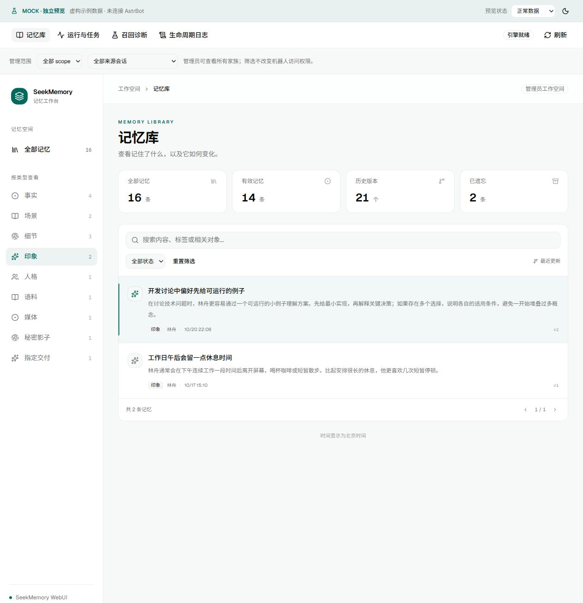
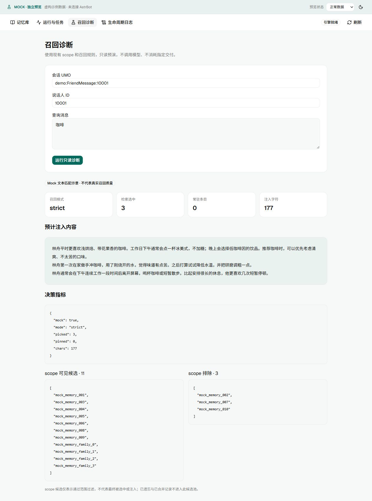
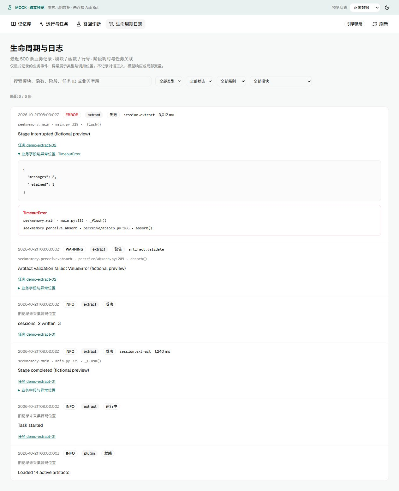

# SeekMemory WebUI 预览资源

本分支只存放预览图片，不合入插件代码分支，也不进入 Release 安装包。

所有数据、来源、账本、任务与错误均为虚构 Mock；日志示例行号不保证与后续代码相同。
Mock 诊断仅做简化文本匹配，不能用于证明真实召回质量。源码位置与业务阶段已另用真实 Python 测试验证。

截图覆盖 9 种记忆类型、版本/关联、编辑/来源/账本、运行检测/确认、诊断命中/空结果、日志明细/筛选/手机布局。
手机深色记忆库沿用此前预览；其余截图为本次复核更新。

| 功能 | 完整预览 |
|---|---|
| 记忆库总览 | [查看](images/webui-memory.png) |
| 事实 | [查看](images/category-fact.png) |
| 场景 | [查看](images/category-scene.png) |
| 细节 | [查看](images/category-detail.png) |
| 印象 | [查看](images/category-impression.png) |
| 人格 | [查看](images/category-persona.png) |
| 语料 | [查看](images/category-example.png) |
| 媒体 | [查看](images/category-media.png) |
| 秘密影子 | [查看](images/category-secret.png) |
| 指定交付 | [查看](images/category-designated.png) |
| 召回诊断：命中、指标和 scope | [查看](images/diagnostics-result.png) |
| 召回诊断：无命中 | [查看](images/diagnostics-empty.png) |
| 诊断结果局部 | [查看](images/diagnostics-scope.png) |
| 业务日志：源码位置、阶段、耗时和异常 | [查看](images/webui-logs.png) |
| 日志组合筛选 | [查看](images/logs-filtered.png) |
| 手机日志布局 | [查看](images/logs-mobile.png) |
| 版本比较 | [查看](images/memory-versions.png) |
| 关联记忆 | [查看](images/memory-relations.png) |
| 手动修订 | [查看](images/webui-editor.png) |
| 历史 blob 与快照 | [查看](images/editor-audit.png) |
| 来源证据与 lineage | [查看](images/editor-evidence.png) |
| 变更账本 | [查看](images/editor-ledger.png) |
| 运行检测与任务 | [查看](images/webui-runtime.png) |
| 维护操作确认 | [查看](images/task-confirmation.png) |
| 手机深色记忆库 | [查看](images/webui-mobile.png) |

## 印象

## 召回诊断：命中、指标和 scope

## 业务日志：源码位置、阶段、耗时和异常

